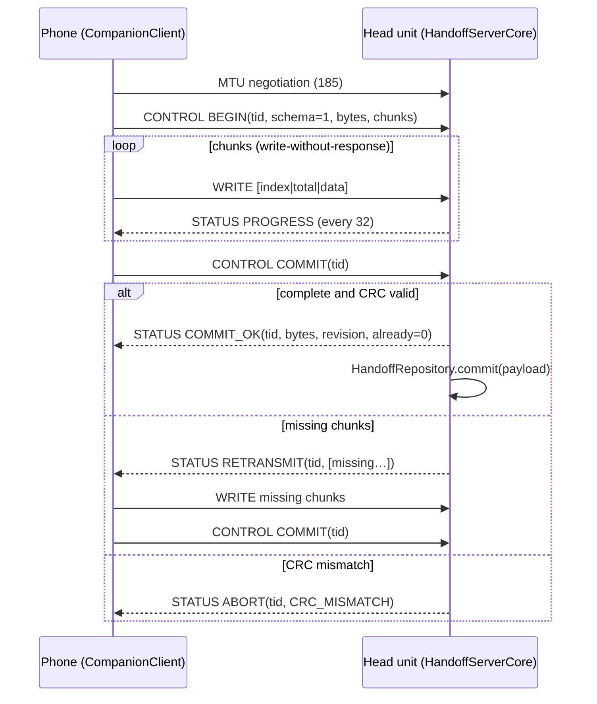

# AutoCockpit companion handoff protocol

Version 1 · schema version 1 · `:core` package `com.autocockpit.core.handoff`

The phone hands the head unit a single `HandoffPayload` (driver profile + recent media queue) over
BLE GATT. The protocol is deliberately small: one service, three characteristics, one binary frame,
a 4-byte chunk header, an explicit commit, and a retransmit bitmap for lossy links.

Everything in this document is implemented in `:core` and runs headless. The Android classes
(`HandoffGattServer`, `BleCompanionClient`) only move bytes.

---

## 1. GATT service

| Characteristic | UUID | Properties | Direction | Purpose |
|---|---|---|---|---|
| Handoff service | `a11c0c70-7e11-4a01-9d00-000000000001` | primary | — | container |
| `HANDOFF_WRITE` | `a11c0c70-7e11-4a01-9d00-000000000002` | write-without-response | phone → HU | chunked frame payload |
| `HANDOFF_CONTROL` | `a11c0c70-7e11-4a01-9d00-000000000003` | write, read | phone → HU / HU → phone | BEGIN / COMMIT / ABORT / RESUME; read returns READY |
| `HANDOFF_STATUS` | `a11c0c70-7e11-4a01-9d00-000000000004` | notify, read | HU → phone | progress, retransmit bitmap, commit result, abort |

The head unit advertises the service UUID and its device name as connectable LE advertising. The
phone enables notifications by writing `0x01 0x00` to the standard CCCD
(`00002902-0000-1000-8000-00805f9b34fb`) of `HANDOFF_STATUS`.

Runtime permissions: `BLUETOOTH_CONNECT`, `BLUETOOTH_ADVERTISE`, `BLUETOOTH_SCAN` (API 31+);
`BLUETOOTH`/`BLUETOOTH_ADMIN` (maxSdk 30).

---

## 2. MTU and chunk size

* Phone requests **MTU 185** (`HandoffProtocol.REQUESTED_MTU`); the head unit accepts anything in
  `23..247`, clamped. `23` is the BLE minimum and the smallest accepted negotiation.
* ATT payload = MTU − 3 (ATT opcode + handle).
* Application chunk payload = ATT payload − 4 (the chunk header below).
  At the default 20-byte ATT payload that is **16 data bytes per chunk**.
* A failed negotiation (< 23) ends the transfer; the link state machine moves to `DEGRADED`.

---

## 3. Frame layout

```
 offset  size  field
 0       1     magic          0xAC   ('A','C' packed into one byte to keep the header 6 bytes)
 1       1     schemaVersion  0x01
 2       2     bodyLength     u16 big endian
 4       2     crc16          CRC-16/CCITT-FALSE over the body only
 6       N     body           TLV: tag u8, length u16 BE, value
```

CRC-16/CCITT-FALSE: polynomial `0x1021`, init `0xFFFF`, no reflection, no final XOR. Check vector:
`CRC("123456789") = 0x29B1`. The frame is rejected (`CRC_MISMATCH`) when the stored CRC differs
from the CRC recomputed over the received body.

### Body TLVs

| Tag | Name | Contents |
|---|---|---|
| `0x01` | profile | nested TLVs (below) |
| `0x02` | queue | nested TLVs (below) |
| `0x03` | meta | `0x01` → `generatedAtMillis` u64 |

Unknown tags are skipped, so a newer peer can add fields without breaking an older reader.
Duplicate known fields are rejected as malformed.

**Profile (`0x01`)**

| Tag | Field | Encoding |
|---|---|---|
| `0x01` | driverId | u16 length + UTF-8 |
| `0x02` | displayName | u16 length + UTF-8 |
| `0x03` | seat | u8 ordinal: 0 driver, 1 passenger, 2 rear-left, 3 rear-right |
| `0x04` | hvacSetpointC | f32 big endian |
| `0x05` | preferredVolume | u8, 0..100 |
| `0x06` | themeAccent | u16 length + UTF-8 |

**Queue (`0x02`)**

| Tag | Field | Encoding |
|---|---|---|
| `0x01` | position | u16 playhead index |
| `0x02` | sourceLabel | u16 length + UTF-8 |
| `0x03` | track | repeated, each value is a nested track TLV |

**Track (inside `0x03`)**

| Tag | Field | Encoding |
|---|---|---|
| `0x01` | id | u16 length + UTF-8 |
| `0x02` | title | u16 length + UTF-8 |
| `0x03` | artist | u16 length + UTF-8 |
| `0x04` | durationMs | u32 |
| `0x05` | uri | u16 length + UTF-8 (`synth://tone/<hz>?id=<id>`) |

Body length is a u16, so the frame limit is 65,535 bytes. A 500-track canonical queue encodes to
**48,002 bytes**; at the 20-byte ATT payload that is **3,001 chunks**.

---

## 4. Chunk header

Every `HANDOFF_WRITE` value is:

```
 0   2   index   u16, 0-based
 2   2   total   u16, total chunks in this frame
 4   ..  data    up to (ATT payload - 4) bytes
```

Chunks may arrive in any order. Duplicates are ignored. A chunk whose `total` differs from the
BEGIN declaration, or whose index is outside `0..<total`, aborts the transfer with
`PROTOCOL_ERROR`. Missing chunks are always recoverable: the head unit keeps the reassembler for the
current transfer id until commit or abort.

---

## 5. Control opcodes (phone → head unit)

| Opcode | Message | Payload |
|---|---|---|
| `0x01` | BEGIN | `transferId` u32, `schemaVersion` u16, `frameBytes` u32, `totalChunks` u16 (13 bytes) |
| `0x02` | COMMIT | `transferId` u32 (5 bytes) |
| `0x03` | ABORT | `transferId` u32, `reason` u8 (6 bytes) |
| `0x04` | RESUME | `transferId` u32 (5 bytes) |

`transferId` is chosen by the phone and must increase when a frame is restarted after a CRC abort.
BEGIN with a schema other than 1 aborts immediately (`SCHEMA_MISMATCH`); the phone must not retry
that payload.

---

## 6. Status notifications (head unit → phone)

| Opcode | Message | Payload |
|---|---|---|
| `0x10` | READY | `schemaVersion` u16, `mtu` u16, `maxFrameBytes` u32 (9 bytes) |
| `0x11` | PROGRESS | `transferId` u32, `receivedChunks` u16, `totalChunks` u16 (9 bytes) |
| `0x12` | RETRANSMIT | `transferId` u32, `count` u16, `count × index` u16 |
| `0x13` | COMMIT_OK | `transferId` u32, `bytes` u32, `revision` u32, `alreadyCommitted` u8 |
| `0x14` | ABORT | `transferId` u32, `reason` u8 |
| `0x15` | RESUME_INFO | `transferId` u32, `totalChunks` u16, `count` u16, `count × missing` u16 |

PROGRESS is sent at most every 32 chunks and on completion. RETRANSMIT is sent in response to an
incomplete COMMIT; the phone resends exactly the listed indices and commits again.

### Abort reasons

| Code | Name | Meaning |
|---|---|---|
| 1 | `SCHEMA_MISMATCH` | peer schema ≠ 1; never retried |
| 2 | `TOO_LARGE` | `frameBytes` > 65,535 or ≤ 0 |
| 3 | `CRC_MISMATCH` | reassembled frame failed the CRC |
| 4 | `PROTOCOL_ERROR` | malformed control/chunk, bad index or total |
| 5 | `NO_TRANSFER` | COMMIT/RESUME for a transfer the head unit does not have |
| 6 | `INCOMPLETE` | commit while chunks are missing (RETRANSMIT is used instead) |
| 7 | `TIMEOUT` | reserved for link-timeout handling |

---

## 7. Transfer sequence



### Resume after a disconnect

1. The phone reconnects and renegotiates the MTU.
2. It writes `CONTROL RESUME(transferId)`.
3. The head unit replies `RESUME_INFO` with the missing indices (or `COMMIT_OK` if the transfer was
   already committed, or `ABORT NO_TRANSFER` if it has no state).
4. The phone resends only the missing chunks and commits again.

Because the reassembler survives the disconnect, a link drop never restarts a 3,001-chunk transfer
from zero.

### Idempotent commit

COMMIT for an already committed `transferId` returns `COMMIT_OK` with `alreadyCommitted = 1` and
the original revision. The repository is not written twice. BEGIN with an already committed
transfer id behaves the same way, so a phone that lost the COMMIT response can simply retry.

### Restart after a CRC abort

A corrupt frame cannot be repaired, so the phone increments `transferId`, sends a new BEGIN with a
fresh reassembler, and retransmits the frame. The client bounds this at 3 restarts and reports the
CRC abort in `HandoffResult`.

---

## 8. Link state machine

`LinkStateMachine` (pure reducer, no coroutines) drives connect/retry/sync reporting:

```
                 start                  peer found            connected             mtu >= 23
 DISCONNECTED ──────────▶ SCANNING ─────────────▶ CONNECTING ───────────▶ NEGOTIATING_MTU ─────────▶ SYNCING
      ▲                      │  ▲                    │                        │                        │
      │ reset                │  │ reconnect tick     │ connect failed         │ mtu < 23 / failed      │ sync failed
      │                      ▼  │                    ▼                        ▼                        ▼
      └────────────────── DEGRADED ◀───────────────────────────────────────────────────────────────────┘
                             │  ▲
                             │  └── reconnect tick (retry budget left)
                             └───── exhausted (5 attempts): stays DEGRADED, UI shows the reason
 SYNCING ── sync completed ──▶ SYNCED ── link lost ──▶ DEGRADED
```

* Backoff: `base 500 ms × 2^(attempt-1)`, capped at 30 s, with ±50 % jitter supplied by a seeded
  `Random` (so tests and the simulation are deterministic).
* Retry budget: 5 attempts. Exhaustion is visible (`exhausted = true`) and never blocks the UI.
* A schema mismatch is fatal (`FATAL` transition) and does not consume retries.
